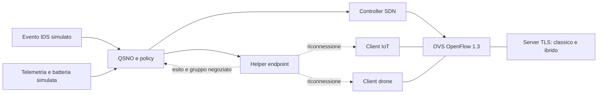

# QSNO — Piano di completamento per l'esame di gennaio 2027

**Autori:** Manuel Ganino e Roberto Di Bella  
**Piano definito il:** 13 novembre 2026  
**Consegna interna completa:** domenica 10 gennaio 2027  
**Disponibilità concordata:** 8 ore a settimana per persona  
**Obiettivo intermedio:** demo integrata e ripetibile entro il 13 dicembre; funzionalità congelate il 20 dicembre.

## 1. Risultato da consegnare

Un prototipo riproducibile su VM Linux che gestisce due client emulati, IoT e drone, collegati a un server tramite uno switch SDN. QSNO seleziona un profilo di scambio chiavi TLS in base a requisiti di sicurezza, capacità dichiarate, condizioni della rete e batteria simulata. Un evento di rischio simulato impone il profilo ibrido; il controller impedisce di continuare a usare il servizio classico quando non è più consentito. Gli endpoint aprono una nuova connessione e QSNO verifica l'esito prima di dichiarare completata la transizione.

La consegna comprende codice, ambiente riproducibile, configurazioni, test essenziali, dati grezzi, grafici, relazione, slide, istruzioni della demo e una registrazione di riserva. La modifica delle funzioni previste dalla proposta va chiarita con il docente nella prima settimana: questo piano realizza TLS e tiene IPsec fuori dal percorso obbligatorio.

### Ambito obbligatorio

1. Topologia Mininet con server, drone, IoT, uno switch OVS e controller remoto.
2. Profili di rete e CPU documentati; batteria come variabile simulata, senza attribuirle misure energetiche reali.
3. Due profili TLS 1.3: scambio classico X25519 e ibrido X25519MLKEM768.
4. Autenticazione del server verificata tramite CA di laboratorio; algoritmo di firma e cifratura dei dati mantenuti uguali fra i due profili.
5. Agent o helper sugli endpoint che eseguono la riconnessione richiesta dal QSNO.
6. Motore di policy deterministico, con requisiti minimi, controllo delle capacità e gestione degli errori.
7. Evento IDS simulato, documentato come tale; nessuna pretesa di rilevare un computer o un attacco quantistico.
8. Enforcement SDN: il servizio classico è bloccato per il client soggetto a policy ibrida obbligatoria.
9. Benchmark separati con liboqs per ML-KEM-768, ML-DSA-44 e Falcon-512, se disponibili nella release fissata; per Falcon dichiarare esattamente l'implementazione, senza equipararla automaticamente a uno standard FN-DSA finale.
10. Confronto sperimentale fra policy classica fissa, ibrida fissa e adattiva, con misure e limiti espliciti.

### Estensioni, soltanto dopo il completamento dell'ambito obbligatorio

- Collegamento di un IDS reale a QSNO al posto del generatore di eventi.
- Firme ML-DSA nell'autenticazione TLS, se lo stack scelto le supporta e il percorso certificati è verificato.
- Transizione con una seconda connessione preparata in anticipo per ridurre l'interruzione.
- Dashboard o interfaccia grafica.
- IPsec/IKEv2, altri algoritmi e misure su hardware ARM reale: sviluppi successivi, non impegni per il 10 gennaio.

Non si scrivono primitive crittografiche, combinatori ibridi o protocolli personalizzati. Un'estensione non può utilizzare le ore necessarie a dati, relazione o prove della demo. Dopo il 20 dicembre non si aggiungono funzionalità.

## 2. Budget di tempo

Le 8 ore settimanali sono disponibilità complessiva, comprensiva di coordinamento, studio, sviluppo, test e scrittura. Per le settimane festive il carico pianificato viene ridotto. Le ore di esecuzione automatica degli esperimenti non sono tutte ore di lavoro umano, ma richiedono una finestra sulla VM.

| Periodo | Capacità del team | Lavoro pianificato | Riserva |
|---|---:|---:|---:|
| 13–15 novembre | 4 h | 3 h | 1 h |
| 16–22 novembre | 16 h | 13 h | 3 h |
| 23–29 novembre | 16 h | 14 h | 2 h |
| 30 novembre–6 dicembre | 16 h | 14 h | 2 h |
| 7–13 dicembre | 16 h | 14 h | 2 h |
| 14–20 dicembre | 16 h | 14 h | 2 h |
| 21–27 dicembre | 8 h | 6 h | 2 h |
| 28 dicembre–3 gennaio | 8 h | 6 h | 2 h |
| 4–10 gennaio | 16 h | 12 h | 4 h |
| **Totale** | **116 h** | **96 h** | **20 h** |

Il carico pianificato è circa 48 ore a persona, con altre 10 ore a persona di riserva. Non è una stima da rispettare a ogni costo: se un'attività supera la previsione, si usa la riserva oppure si riducono le estensioni e la complessità, mantenendo l'intero percorso dimostrativo.

## 3. Divisione del lavoro e collaborazione

I nomi A e B sono ruoli da assegnare a Manuel e Roberto, senza presumere le rispettive preferenze.

| Area | Responsabile A — rete e controllo | Responsabile B — crittografia ed esperimenti |
|---|---|---|
| Ambiente | Mininet, OVS, controller, accesso alla VM | OpenSSL, liboqs, build e dipendenze |
| Prototipo | Topologia, motore QSNO, regole OpenFlow | Servizi TLS, helper client, verifica del gruppo negoziato |
| Misure | Eventi, tempi della decisione e applicazione SDN | Apertura canale, CPU/RAM, traffico e raccolta dati |
| Relazione | Architettura, policy, minacce e limiti SDN | Primitive, metodologia, risultati e grafici |
| Consegna | Avvio, reset, sceneggiatura della demo | Riproducibilità dello stack, dati, registrazione |

Ogni componente ha un responsabile, ma l'altro studente lo deve saper avviare e spiegare. A ogni milestone si scambiano la conduzione della demo.

**Ritmo ordinario per persona:** circa 30 minuti di coordinamento, due sessioni da 2 ore di lavoro autonomo, circa 2 ore di integrazione/verifica e circa 1,5 ore di documentazione o riserva. Nelle settimane festive: circa 4 ore a testa disponibili, 3 pianificate.

**Git e VM condivisa:** usare due directory di lavoro distinte, tramite cloni separati o worktree; due sessioni SSH nella stessa directory condividerebbero il branch attivo. Conservare i branch previsti, con PR verso `develop` e revisione dell'altro studente. `main` riceve soltanto milestone verificate. Niente build, benchmark pesanti o due istanze Mininet concorrenti durante le misure. Prenotare le finestre sulla VM in una nota condivisa.

**Issue:** ogni attività deve indicare responsabile, risultato atteso, verifica, stima e dipendenze. Nessuna PR deve limitarsi a «compila»: allegare il controllo funzionale rilevante e aggiornare la documentazione quando cambia l'uso.

## 4. Architettura da implementare



### Rete di laboratorio

| Nodo | IP proposto | Ruolo |
|---|---|---|
| `h_server` | `10.0.0.1` | Due servizi TLS con profili rigorosamente separati |
| `h_iot` | `10.0.0.2` | Client con quota CPU ridotta e batteria simulata bassa |
| `h_drone` | `10.0.0.3` | Client con quota CPU maggiore; canale degradabile |
| `s1` | Non necessario al traffico applicativo | Switch OVS, OpenFlow 1.3 |
| Controller e QSNO | Processi della VM | Piano di controllo e orchestrazione |

Il servizio classico ascolta per esempio su `4433`, quello ibrido su `4434`. Sono due listener sullo stesso server, con certificato e cifratura dei dati invariati. Questo evita di dover riavviare un servizio condiviso o riscrivere dinamicamente l'intero server per applicare una policy a un solo client. La porta non prova quale crittografia sia stata negoziata: la verifica deve provenire anche dallo stack TLS.

Il controller applica ACL per client e servizio. Le regole di blocco devono prevalere sulle regole di forwarding, comprese quelle già installate: adottare una tabella ACL prima della tabella di inoltro, oppure priorità esplicite con verifica dei flussi. ARP e traffico di ritorno necessario devono funzionare. Non sono richiesti NAT, modifica del ClientHello o decifratura sullo switch.

Tailscale e SSH servono all'amministrazione e non sono parte del percorso dei pacchetti dell'esperimento. Per il PoC il canale di gestione può usare comunicazione locale con permessi restrittivi e interfacce limitate al laboratorio. Una soluzione semplice è usare socket Unix per QSNO/helper; l'interfaccia del controller deve essere accessibile soltanto al processo di gestione autorizzato. Il modello di minaccia considera attendibili VM, amministratori e processi di controllo; compromissione root, falsificazione dell'identità del nodo e sicurezza di una distribuzione remota sono fuori ambito.

### Stack da fissare entro il 22 novembre

- Ubuntu 22.04 LTS già scelta, con risorse assegnate alla VM registrate.
- Mininet, OVS e OpenFlow 1.3 con un test esplicito del controller remoto.
- Ryu se l'ambiente funziona in modo riproducibile; OS-Ken come alternativa tecnica, da concordare con il docente se Ryu è un vincolo del corso. Il repository Ryu dichiara di non essere mantenuto: non dedicare una settimana a risolverne le dipendenze.
- OpenSSL della linea 3.5, con una patch mantenuta selezionata, verificata e fissata nella prima settimana; installazione isolata che non sostituisce l'OpenSSL di sistema.
- liboqs da release/tag fissato con SHA e opzioni di build registrati. Selezionare gli algoritmi necessari e limitare il parallelismo della compilazione alle risorse disponibili.
- `oqs-provider` soltanto se serve per gli algoritmi effettivamente sperimentati. OpenSSL 3.5 fornisce ML-KEM/ML-DSA nativi: i risultati TLS nativi e i microbenchmark liboqs devono essere etichettati come implementazioni diverse.
- Python per orchestrazione, helper, raccolta e analisi, con dipendenze fissate.

Gli strumenti OpenSSL `s_client` e `s_server` servono per i primi test e possono essere pilotati dai helper per il servizio dimostrativo. Entro il 29 novembre verificare che l'interfaccia scelta consenta messaggi applicativi, timeout e prova del gruppo negoziato; se non basta, realizzare un piccolo client/server usando le API OpenSSL, senza cambiare primitive o protocollo. Questa decisione deve avvenire prima dell'integrazione.

## 5. Policy, stati e interfacce

### Due profili crittografici

| Campo | `CLASSIC` | `HYBRID` |
|---|---|---|
| Protocollo | TLS 1.3 | TLS 1.3 |
| Gruppo | X25519 | X25519MLKEM768 |
| Cifratura dei dati | Stessa AEAD, per esempio AES-256-GCM | Identica al profilo classico |
| Autenticazione | Certificato e firma classici verificati | Identici al profilo classico |
| Servizio proposto | `h_server:4433` | `h_server:4434` |

Un profilo ibrido di scambio chiavi non rende automaticamente post-quantistica l'autenticazione. ML-DSA e Falcon sono inizialmente studiati in benchmark separati. Una variazione delle firme TLS costituirebbe un ulteriore esperimento, non una variabile da cambiare insieme al KEM.

### Input minimi

Per ogni client/flusso: identificativo, peer, profili supportati, requisito minimo, stato di rischio, batteria simulata, profilo di rete, profilo attivo e identificativo dell'ultima policy applicata. Le condizioni imposte dagli script di rete sono note e dichiarate; i valori raccolti con probe o contatori vengono marcati separatamente come misurati.

Non è necessario stimare automaticamente la capacità hardware. La lista delle capacità è configurata e validata all'avvio. La batteria è una variabile di scenario; non diminuisce secondo una legge energetica presentata come sperimentalmente verificata.

### Regole ordinate per priorità

1. Requisito minimo ibrido oppure rischio alto: richiedere `HYBRID`.
2. Profilo richiesto non supportato da uno dei peer: bloccare il flusso e registrare il motivo; niente fallback silenzioso.
3. Rischio basso, classico esplicitamente consentito e batteria bassa o rete vincolata: consentire la scelta `CLASSIC` secondo soglie documentate.
4. Negli altri casi compatibili: preferire `HYBRID`.
5. L'allarme alto resta attivo fino a un reset esplicito; un messaggio di rischio basso non causa da solo un downgrade.

Le soglie sono parametri del PoC, non conclusioni scientifiche. Valori iniziali possibili: batteria sotto il 30% e permanenza minima nello stato di 10 secondi. La condizione «rete vincolata» viene associata al profilo di test, con parametri espliciti. L'adeguatezza prestazionale di questa scelta è un'ipotesi da valutare: QSNO potrebbe non ottenere vantaggi in tutti gli scenari.

### Stati minimi

`CLASSIC_ACTIVE`, `HYBRID_ACTIVE`, `TRANSITION`, `BLOCKED`. Conservare separatamente `desired_profile` e `observed_profile`; un comando inviato non equivale a una transizione riuscita.

### Sequenza di transizione verso il profilo obbligatorio

1. Validare evento, target e capacità; generare una versione della policy.
2. Registrare decisione e profilo richiesto con un orologio monotono.
3. Chiedere al controller di consentire il servizio ibrido e vietare quello classico per il client; attendere la conferma di elaborazione OpenFlow prevista e verificare anche l'effetto sul traffico.
4. Fermare l'uso della vecchia connessione e chiedere al helper di aprirne una nuova con il profilo richiesto.
5. Verificare certificato, gruppo negoziato e ricezione di una risposta applicativa.
6. Registrare `HYBRID_ACTIVE` soltanto dopo tali verifiche.
7. Se scade il timeout configurato o fallisce la verifica, registrare `BLOCKED`, con tentativi limitati e senza riaprire il classico vietato.

La prima versione accetta un'interruzione breve e la misura. Non promette una rinegoziazione TLS 1.3 sulla stessa connessione. `KeyUpdate` non viene usato per simulare un cambio di KEM.

### Contratto fra i componenti, da fissare entro il 22 novembre

Il formato può essere JSON, senza imporre un framework web:

- Evento: `event_id`, `target_id`, `severity`, `source`, `timestamp`.
- Richiesta: `policy_id`, `target_id`, `required_profile`, `reason`, `timeout_ms`.
- Esito: `policy_id`, `status`, `observed_group`, `certificate_ok`, `application_ack`, `error`.
- Telemetria: `target_id`, `battery_simulated`, `network_profile`, `cpu_quota`, `supported_profiles`.

Eventi duplicati non devono generare riconnessioni ripetute; dati malformati, target sconosciuti e comandi arbitrari vanno rifiutati. Un nuovo evento alto deve essere trattato prontamente, mentre i cambiamenti non urgenti usano un tempo di stabilizzazione per evitare oscillazioni.

## 6. Calendario operativo e verifiche di completamento

### 13–15 novembre — avvio e scelte, 3 ore team

**Insieme:** assegnare A/B; trasformare il piano in una checklist locale o issue; confermare la disponibilità della VM; predisporre directory Git separate; scegliere il percorso TLS e annotare le differenze rispetto alla proposta.

**Risultato:** ruoli assegnati, backlog ordinato, piano leggibile da entrambi. Preparare la richiesta di allineamento al docente; l'invio è una vostra attività, non un prerequisito per i lavori di ambiente.

### 16–22 novembre — ambiente e prove separate, 13 ore team

**A, circa 6,5 ore:** verificare controller remoto, OpenFlow 1.3, accesso SSH; creare topologia base e configurazione degli host; scrivere avvio e pulizia; documentare risorse della VM.

**B, circa 6,5 ore:** fissare OpenSSL/liboqs e percorso di installazione; generare CA/certificato di laboratorio; eseguire handshake classico e ibrido fuori da Mininet con verifica del server; predisporre un primo test liboqs; registrare versioni e comandi.

**Insieme:** definire messaggi fra componenti e profili TLS; confermare con il docente l'ambito del PoC. Tutte le attività rientrano nelle 13 ore.

**Milestone M1, 22 novembre:** rete a tre host funzionante e controller remoto verificato; handshake ibrido reale funzionante separatamente; versioni riproducibili. `pingall` da solo non dimostra il funzionamento di Ryu.

### 23–29 novembre — traffico TLS nella topologia, 14 ore team

**A, circa 7 ore:** aggiungere profili di link e quota CPU; verificare la compatibilità del meccanismo CPU con il sistema della VM; implementare un primo comando per consentire/bloccare una porta TLS per client; assicurare che non venga aggirato da flussi già presenti.

**B, circa 7 ore:** avviare i due servizi TLS su `h_server`; implementare helper client, sequenze di messaggi e riconnessione manuale; verificare gruppo e certificato; completare i test liboqs e raccogliere primi campioni ML-KEM/ML-DSA/Falcon.

**Milestone M2, 29 novembre:** IoT e drone scambiano messaggi su entrambi i profili nella rete Mininet; un comando manuale cambia connessione; il blocco SDN impedisce il servizio vietato. I messaggi contengono numeri di sequenza per osservare perdita e ripresa del servizio.

### 30 novembre–6 dicembre — integrazione QSNO, 14 ore team

**A, circa 7 ore:** implementare motore di policy, stati, validazione degli eventi e integrazione col controller; aggiungere conferma e versionamento della policy; testare priorità e requisito minimo.

**B, circa 7 ore:** collegare helper e orchestratore; implementare timeout, esiti e verifica del gruppo osservato; aggiungere log strutturati e driver di scenario; raccogliere i tempi principali.

**Milestone M3, 6 dicembre:** un evento alto simulato causa automaticamente blocco del classico, nuova connessione ibrida e conferma applicativa. Se il nuovo profilo fallisce, il sistema resta bloccato e lo segnala. Nessun passaggio manuale durante la transizione principale.

### 7–13 dicembre — robustezza e demo completa, 14 ore team

**A, circa 7 ore:** testare capacità mancanti, eventi duplicati, protezione da downgrade e modifica delle condizioni; verificare il mantenimento delle regole SDN e preparare sceneggiatura/diagnostica.

**B, circa 7 ore:** stabilizzare raccolta dati, verifica dei certificati e classificazione degli errori; preparare matrice degli esperimenti e grafici su dati pilota; eseguire prove ripetute con A.

**Milestone M4, 13 dicembre:** demo eseguita da entrambi da uno stato pulito, per tre prove consecutive senza interventi correttivi sul codice; casi di errore essenziali verificati; protocollo degli esperimenti fissato.

### 14–20 dicembre — esperimenti e congelamento delle funzionalità, 14 ore team

**A, circa 7 ore:** eseguire scenari e verificare enforcement/tempi; completare architettura, policy e modello di minaccia nella relazione; analizzare le anomalie con B.

**B, circa 7 ore:** condurre la campagna automatizzata, microbenchmark e controlli dei dati; produrre grafici provvisori; scrivere ambiente, metodologia e risultati preliminari.

**Milestone M5, 20 dicembre:** campagna principale completata, dati grezzi conservati, grafici rigenerabili e prima bozza sostanziale della relazione. Congelare le funzionalità; da qui in avanti solo correzioni, analisi e preparazione della consegna.

### 21–27 dicembre — analisi e relazione, 6 ore team

**A, circa 3 ore:** rileggere risultati e limiti; completare le parti SDN/policy e spiegare i casi di blocco.

**B, circa 3 ore:** completare grafici/tabelle e parti crittografiche; distinguere dati misurati da variabili simulate; correggere le generalizzazioni dell'analisi preventiva.

**Milestone M6, 27 dicembre:** bozza completa della relazione, con risultati e conclusioni coerenti con i dati. Ripetere misure soltanto se emergono errori o lacune materiali.

### 28 dicembre–3 gennaio — riproducibilità e materiali d'esame, 6 ore team

**A, circa 3 ore:** verificare README, comandi di avvio/reset, guida della demo e ordine delle slide.

**B, circa 3 ore:** verificare installazione/build in ambiente pulito o snapshot controllato; rifinire grafici e creare la registrazione della demo.

**Insieme:** lettura incrociata e prova orale, comprese nelle ore previste.

**Milestone M7, 3 gennaio:** release candidata, relazione completa, slide in bozza, demo registrata e procedura riproducibile verificata. Se il controllo richiede più tempo, usare la riserva disponibile prima di aggiungere qualsiasi estensione.

### 4–10 gennaio — consegna finale, 12 ore team

**A, circa 6 ore:** correggere gli ultimi problemi di rete/avvio; finalizzare relazione e slide con B; condurre una prova completa dell'esposizione.

**B, circa 6 ore:** verificare dati e pacchetto di consegna; finalizzare la registrazione e i grafici; condurre una seconda prova completa con ruoli scambiati.

**Milestone M8, 10 gennaio:** versione finale su `main` secondo il vostro flusso, tag `v1.0.0`, relazione e slide esportate, dati/grafici disponibili, backup offline e demo funzionante da snapshot noto. Merge, tag e pubblicazione sono attività da eseguire al momento opportuno; questo documento non le esegue.

## 7. Esperimenti: cosa dimostrare e come

### Domande di ricerca

1. QSNO applica realmente il profilo richiesto e impedisce di proseguire sul classico quando vietato?
2. Quanto tempo passa dall'evento alla prima risposta applicativa sul profilo richiesto?
3. Come cambiano costo di apertura del canale, traffico e disponibilità del servizio al variare di CPU e rete?
4. Quali costi e limiti presenta la policy adattiva rispetto alle due policy fisse?

Non è necessario dimostrare che l'adattamento sia sempre più veloce. Un risultato negativo è valido se il confronto è controllato e spiegato.

### Parametri iniziali degli scenari

| Parametro | Condizione nominale | Condizione degradata |
|---|---|---|
| Link client–switch | 10 Mbit/s | 1 Mbit/s |
| Ritardo aggiunto per direzione sul link client | 5 ms | 40 ms |
| Perdita configurata | 0% | 1% |
| MTU | 1500 byte | 1500 byte |

Il link server–switch resta uguale nelle prove. Il ritardo nella tabella non è l'RTT complessivo: va descritto e verificato con un probe. La perdita è applicata secondo la configurazione di Mininet/traffic control, che va conservata. IoT e drone differiscono per quota CPU documentata e batteria di scenario; quote iniziali possibili sono 0,1 e 0,5, da validare con la semantica della versione Mininet e l'hardware della VM. Non attribuire a questi numeri un'equivalenza con un processore ARM specifico. Non imporre limiti RAM estremi per imitare microcontrollori che questo ambiente non emula.

### Campagna principale

- Tre policy: classica fissa, ibrida fissa, adattiva.
- Due profili client: IoT e drone.
- Due condizioni di rete: nominale e degradata.
- Almeno 30 ripetizioni per combinazione: **360 prove** complessive.
- Prove seriali, con ordine mescolato e seed/ordine salvati; niente compilazioni o carichi estranei durante le misure.
- Ogni prova usa lo stesso carico, per esempio messaggi numerati di circa 1 KiB ogni 500 ms per 20 secondi, con evento al secondo 10. Validare la durata nelle prove pilota prima di fissarla.
- Una nuova connessione per prova; evitare resumption e 0-RTT nel confronto principale.

La classica fissa è un riferimento sperimentale: al segnale alto continua a usare il classico e viene classificata come non conforme al nuovo requisito. Non è una policy di produzione proposta. L'ibrida fissa può essere già conforme senza alcuna transizione. Nell'adattiva il profilo iniziale dipende dal contesto; un evento che trova già attivo l'ibrido è un caso senza transizione, da registrare senza inventare un tempo di handshake pari a zero.

Per misurare specificamente la transizione di entrambi i client, aggiungere una serie controllata con stato iniziale classico esplicitamente consentito e successivo requisito ibrido: 30 ripetizioni per client nella condizione nominale, se la campagna principale non fornisce già campioni sufficienti. Usare le prove della campagna principale quando coincidono; evitare duplicazioni inutili.

### Microbenchmark crittografici

- ML-KEM-768: key generation, encapsulation e decapsulation.
- ML-DSA-44 e Falcon-512: key generation, firma e verifica.
- Registrare livello di sicurezza dichiarato, dimensioni, implementazione, opzioni di build, istruzioni CPU e numero di iterazioni.
- Usare gli strumenti di benchmark/test della release liboqs scelta; effettuare un breve warm-up ed esecuzioni ripetute con numero di operazioni dichiarato.
- Separare questi risultati da quelli TLS/OpenSSL. Non sommare direttamente tempi provenienti da implementazioni diverse per predire un handshake.

### Metriche e definizioni

| Metrica | Definizione da usare |
|---|---|
| Apertura del canale | Tempo fra richiesta di connessione e TLS pronto; se include avvio del processo/TCP, dichiararlo nel nome e nel report |
| Handshake TLS puro | Riportarlo solo se gli istanti di inizio/fine TLS sono effettivamente strumentati, non come sinonimo del tempo totale di comando |
| Tempo di decisione | Da ricezione dell'evento valido a policy decisa |
| Tempo di applicazione SDN | Da invio della modifica a conferma del controller/switch, con verifica funzionale separata |
| Tempo di reazione completo | Da ricezione dell'evento alla prima risposta applicativa valida sul profilo richiesto |
| Interruzione osservata | Distanza temporale fra ultima risposta prima della transizione e prima risposta dopo; riportare anche la cadenza normale dei messaggi |
| Traffico | Byte/pacchetti del flusso nella finestra definita, ricavati da pcap o contatori con filtro e livello di conteggio dichiarati |
| CPU e RAM | CPU user/system e picco RSS del processo pertinente; distinguere helper, applicazione e controller |
| Esito | Successo, timeout, certificato rifiutato, profilo incompatibile, gruppo inatteso o blocco previsto |
| Conformità | Profilo osservato soddisfa il requisito corrente; eventuale finestra prima dell'enforcement misurata esplicitamente |

Usare un orologio monotono comune per gli eventi locali alla VM. Salvare almeno `run_id`, commit, versione software, scenario, client, policy, gruppo richiesto/osservato, tempi, esito e motivo dell'errore. Non eliminare i timeout dalle tabelle: riportare tasso di successo e distribuzioni dei tempi con numerosità esplicita.

Produrre mediana e intervallo interquartile; riportare p95 con cautela dato il campione limitato. Almeno quattro figure: costo di apertura canale per profilo/rete; byte scambiati; tempo di reazione/interruzione nei casi di transizione; confronto di conformità ed esiti delle tre policy. CPU/RAM e firme possono stare in tabelle o figure aggiuntive. Etichettare unità, numero di prove e parametri.

## 8. Verifiche essenziali

1. Controller remoto connesso e regole OpenFlow effettivamente applicate.
2. Handshake dei due profili con certificato verificato; certificato non attendibile rifiutato.
3. Nessun profilo classico negoziato quando viene richiesto esclusivamente l'ibrido.
4. Il blocco del classico vale anche per flussi già aperti e non interrompe il client non interessato.
5. Evento alto: decisione, enforcement e riconnessione producono un esito verificato.
6. Peer senza supporto ibrido: blocco esplicito, non fallback classico.
7. Handshake fallito o helper indisponibile: stato coerente, timeout limitato e assenza di successi falsi.
8. Evento duplicato o target inesistente: niente riconnessioni a catena né comandi arbitrari.
9. Variazione di batteria/rete in un contesto che permette il classico: decisione coerente con la matrice, senza oscillazioni continue.
10. Un semplice evento basso non rimuove un allarme alto; reset esplicito e documentato.
11. Avvio, stop e reset eliminano soltanto processi e stato del test identificati; non disturbano le sessioni del collega.
12. Un secondo studente riproduce la demo seguendo il README, senza istruzioni a voce aggiuntive.

Test automatici piccoli e mirati per priorità delle policy, capacità, eventi duplicati e stati di errore. Gli aspetti TLS/OpenFlow richiedono verifiche integrate sulla VM; controlli statici su Mac o Windows non li sostituiscono. Automazioni locali/GitHub Actions possono verificare logica e formato dei dati; non presentarle come prova di funzionamento Mininet se non lo eseguono.

## 9. Rischi e decisioni di recupero

| Segnale | Decisione |
|---|---|
| Ryu non si installa/avvia entro una sessione di lavoro | Provare una combinazione documentata e fissata; valutare OS-Ken, con allineamento al docente se necessario. Evitare tentativi senza limite |
| Handshake ibrido assente al 22 novembre | Concentrare la riserva sullo stack OpenSSL isolato; sospendere firme TLS, provider non necessari e qualsiasi interfaccia grafica |
| TLS funziona fuori da Mininet ma non nella topologia al 29 novembre | Verificare percorsi binari, certificati, MTU, regole e connettività; mantenere topologia minima, senza aggiungere apparati |
| Transizione automatica incompleta al 6 dicembre | Ridurre la policy a due profili e un solo evento; mantenere riconnessione semplice con interruzione misurata |
| Demo instabile al 13 dicembre | Nessuna estensione; usare riserva su timeout, reset e casi di errore prima degli esperimenti |
| Falcon non disponibile nella build fissata | Documentare il motivo e limitare la ricerca della soluzione a una sessione; mantenere ML-KEM e ML-DSA, presentando Falcon come confronto da letteratura chiaramente separato se necessario |
| Campagna non completa al 20 dicembre | Eliminare scenari aggiuntivi; preservare le tre policy e almeno una condizione nominale e una degradata. Se si riducono le ripetizioni, dichiarare numerosità e limiti senza compensare con dati inventati |
| Primo risultato non mostra un vantaggio prestazionale di QSNO | Verificare la metodologia e presentare il trade-off osservato; non modificare i dati o scegliere solo scenari favorevoli |
| Problema hardware/VM a gennaio | Ripartire da snapshot noto e materiali offline; usare registrazione e risultati già esportati per la presentazione |

Non usare la riserva per allargare il progetto. Se il docente richiede anche IPsec o un IDS reale come requisito obbligatorio, ricalcolare il piano nella prima settimana, sostituendo altre attività oppure aumentando le ore disponibili: non trattare una seconda integrazione completa come gratuita.

## 10. Struttura proposta del repository

```text
README.md
configs/           # host, link, profili TLS, policy e scenari
topology/          # topologia Mininet
controller/        # applicazione Ryu/OS-Ken e enforcement
qsno/              # logica, stati e contratti dei messaggi
agents/            # helper endpoint e verifica TLS
scripts/           # setup, avvio, reset, esperimenti, analisi
tests/             # policy e verifiche integrate essenziali
results/           # dati grezzi leggeri e grafici esportati
docs/              # architettura, piano, metodologia, demo
```

Non versionare build, ambienti Python, chiavi private, key log TLS o grandi pcap. Generare certificati di laboratorio con uno script. Conservare i pcap e il video in un pacchetto locale o archivio accessibile concordato, indicato nella guida di consegna; mantenere nel repository i risultati necessari a rigenerare i grafici. Se si usano snapshot, conservare separatamente le istruzioni di installazione: uno snapshot funzionante non dimostra da solo la riproducibilità.

## 11. Relazione, slide e demo

### Relazione: struttura proposta, circa 12–18 pagine più appendici

1. Problema e domanda di ricerca.
2. Background essenziale: SDN, TLS 1.3, KEM, firme, approccio ibrido.
3. Modello di minaccia e requisiti minimi.
4. Architettura e separazione fra controllo dei flussi e controllo degli endpoint.
5. Policy, stati, transizioni e gestione dei fallimenti.
6. Ambiente e metodologia: versioni, VM, scenari, ripetizioni, metriche.
7. Risultati comparativi e microbenchmark.
8. Discussione: vantaggi, costi, risultati negativi, limiti dell'emulazione.
9. Conclusioni e sviluppi futuri, distinguendo chiaramente ciò che è implementato.
10. Riferimenti e appendice con comandi/manifest delle prove.

Correggere nell'analisi preventiva almeno: semplificazione su AES-128/Grover; confusione fra MAC e SLH-DSA; sovrapposizione fra segmentazione TCP e frammentazione IP; overhead ibrido dato per sempre doppio; percentuali prestazionali derivate solo dai round; equivalenza implicita fra Falcon disponibile e FN-DSA finale. Presentare CPU/banda/batteria come dimensioni distinte.

### Slide: circa 10–12, da adattare al tempo comunicato dal docente

Problema, obiettivo e ambito; architettura; policy; transizione; ambiente; metodologia; due/tre risultati principali; gestione di un errore; limiti; contributi personali e sviluppi futuri. Evitare di riempire le slide di codice o liste di tutti gli algoritmi conosciuti.

### Demo di circa 5–7 minuti

1. Avvio da stato noto e visualizzazione della topologia.
2. Traffico normale, profilo attivo e gruppo negoziato.
3. Evento alto per un client in stato classico consentito.
4. Decisione QSNO, blocco del classico, riconnessione ibrida e ripresa dei messaggi.
5. Mostrare un tentativo sul servizio classico rifiutato.
6. Mostrare un client senza capacità ibrida e il relativo blocco esplicito.
7. Aprire un grafico già generato con le misure e spiegare un limite dell'esperimento.

Preparare una registrazione breve, snapshot della VM e risultati esportati; il giorno dell'esame non deve dipendere da download o aggiornamenti. Entrambi devono saper spiegare perché servono gli agent, perché TLS richiede un nuovo handshake, cosa prova l'IDS simulato e perché Mininet non misura la batteria reale.

## 12. Checklist finale del 10 gennaio

- [ ] La topologia parte seguendo il README da uno stato pulito.
- [ ] Entrambi i profili TLS sono verificati, compresi certificato e gruppo negoziato.
- [ ] La policy cambia realmente il comportamento degli endpoint e l'accesso ai servizi.
- [ ] Capacità mancanti e fallimenti producono blocchi coerenti, senza downgrade silenzioso.
- [ ] Le misure distinguono setup del canale, decisione, applicazione e interruzione.
- [ ] Dati grezzi, configurazioni e manifest identificano il codice usato.
- [ ] Grafici e tabelle sono rigenerabili dai dati conservati.
- [ ] Le conclusioni non attribuiscono al laboratorio proprietà hardware o energetiche non misurate.
- [ ] Relazione e slide descrivono l'implementazione effettiva.
- [ ] Demo eseguita da entrambi, registrazione pronta e backup disponibile.
- [ ] Codice stabile integrato secondo il flusso del team e versione finale identificata.

## 13. Fonti tecniche di riferimento

Consultate per definire il piano; versioni concrete da registrare nella milestone M1.

- [TLS 1.3 — RFC 8446](https://www.rfc-editor.org/rfc/rfc8446.html): negoziazione, assenza di rinegoziazione e KeyUpdate.
- [OpenSSL s_client](https://docs.openssl.org/3.5/man1/openssl-s_client/) e [s_server](https://docs.openssl.org/3.5/man1/openssl-s_server/): strumenti per verificare e pilotare i profili.
- [OQS Provider](https://github.com/open-quantum-safe/oqs-provider): compatibilità con OpenSSL e disponibilità degli algoritmi.
- [Configurazione liboqs](https://github.com/open-quantum-safe/liboqs/blob/main/CONFIGURE.md): selezione degli algoritmi e opzioni di build.
- [Repository Ryu](https://github.com/faucetsdn/ryu): stato di manutenzione e alternativa OS-Ken indicata dal progetto.
- [Mininet Overview](https://mininet.org/overview/): architettura e limiti dell'emulazione.
- [NIST PQC](https://csrc.nist.gov/projects/post-quantum-cryptography): stato della standardizzazione.
- [NIST FAQ PQC](https://csrc.nist.gov/projects/post-quantum-cryptography/faqs): precisazioni su AES e minaccia quantistica.
- [SLH-DSA in liboqs](https://openquantumsafe.org/liboqs/algorithms/sig/slh-dsa.html): tipo di primitiva e dimensioni delle firme.
